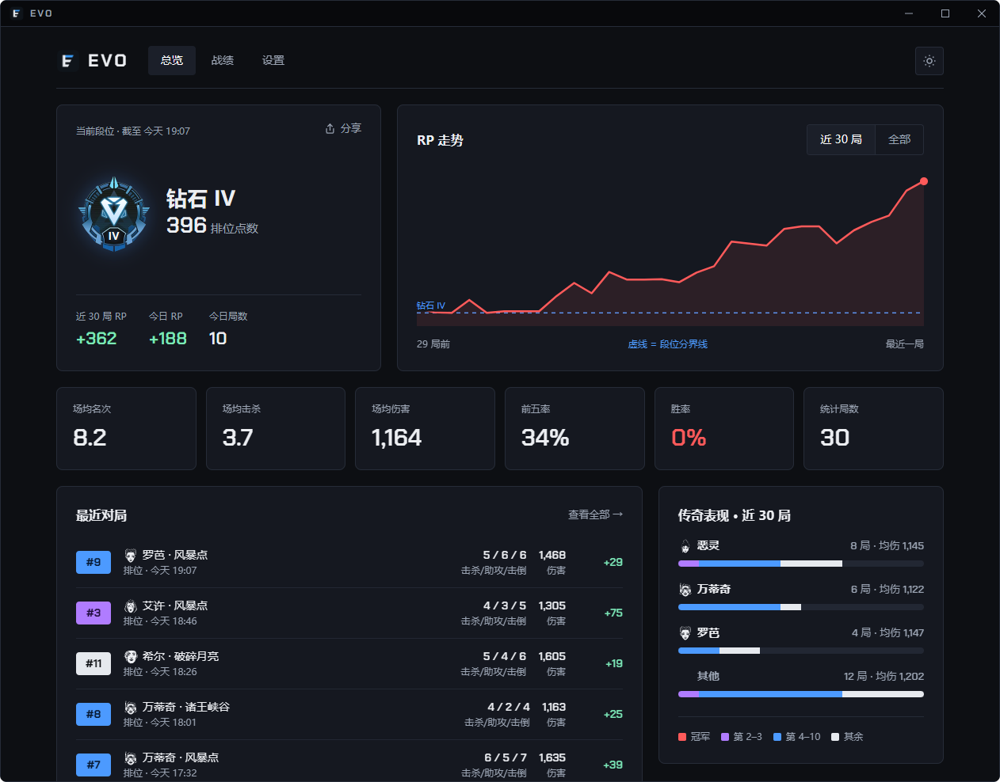
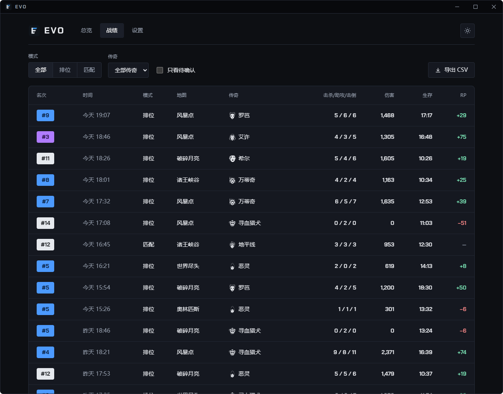
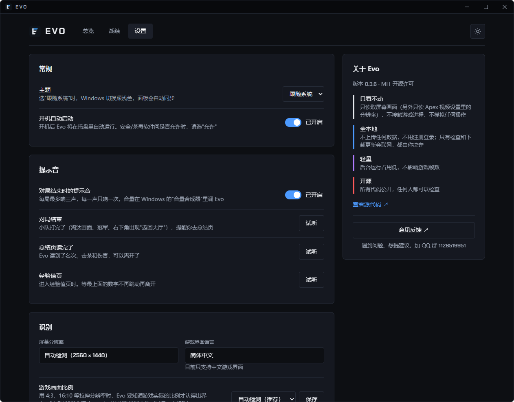

# Evo

**本地、开源、轻量的战绩记录器 · for Apex Legends**

打 Apex 时，Evo 在后台自动记下每一局的名次、击杀、伤害和排位分（RP）变化，在自己的窗口里看战绩和段位走势。所有数据只保存在你自己的电脑上。

> 现在是 **预览版**：只支持简体中文游戏界面，只在排位赛里测过。官网和下载：**[evotracker.cn](https://evotracker.cn)**

## 功能

- **自动记录每一局**：名次、击杀 / 助攻 / 击倒、老板分、伤害、生存时间、急救、重生，结算画面一出现就自动读取；开局时顺便记下模式和地图，对局中认出你和队友用的传奇。很快跳过了结算画面也不怕：击杀、助攻、伤害、RP 用对局中右上角最后读到的数
- **RP 与段位走势**：从经验值页读出本局 RP 变化和段位进度；每次回到大厅读一次段位和分数，用它核对、补上每一局的 RP，连成走势图，上分还是掉分一眼看清
- **读不准就问你**：识别把握不大的局不会悄悄写进错误数据，而是标成"待确认"，留着截图，你在战绩页对着截图改一下就行
- **全本地**：没有账号，不上传任何数据。战绩可以一键导出 CSV，用 Excel、Stata 等工具分析
- **轻量**：平时安静地待在托盘里；发现游戏在运行才开始记录，游戏一关，识别程序就退出，内存还给系统
- **多账号**：按游戏里的名字区分账号，大小号的战绩分开统计

| 战绩：每一局的明细，可以筛选、修正、导出 | 设置：开机自启、提示音、识别，都在这里调 |
|---|---|
|  |  |

截图里是演示数据。

## 只看屏幕，不碰游戏

Evo 和录屏软件一样，只截取屏幕上显示的画面，再在你自己的电脑上识别其中的文字。0.3.5 起另外会读 Apex 自己的视频设置文件里的分辨率（只读不改），用来判断游戏画面是 16:9、16:10 还是 4:3。

| Evo 做的 | Evo 绝不做的 |
|---|---|
| 截取屏幕画面（和录屏软件相同的截屏方式） | 注入游戏，或读写游戏内存 |
| 在你的电脑上识别画面里的文字和数字 | 在游戏画面上叠加任何浮层 |
| 把结果存进本机的数据库 | 模拟键盘、鼠标操作 |
| 读 Apex 视频设置文件里的分辨率，判断画面比例（0.3.5 起，只读不改） | |
| | 查看其他玩家的段位，或提供任何竞技优势 |
| | 把你的数据上传到网络 |

作者自己开着 Evo 打过整晚的排位，没有遇到问题。但反作弊如何判定由 EA 决定，我们无法替 EA 作出保证。请了解以上做法后，自行决定是否使用。

## 下载和安装

**能不能用：**

- Windows 10 或 11（64 位）
- 游戏界面语言是**简体中文**（英文界面现在认不出）
- 游戏画面是 16:9，例如 1920×1080 或 2560×1440；0.3.5 起也支持 16:10 和 4:3（包括 4:3、16:10 拉伸分辨率），要用全屏或无边框窗口，不支持窗口模式

**安装：**

1. 在 [官网](https://evotracker.cn/#download) 下载压缩包（约 103 MB，官网上有 SHA-256 可以核对）
2. 把整个压缩包**解压**到一个文件夹，比如 `D:\Evo`。不要在压缩包里直接双击运行
3. 双击 `Evo.exe`。Evo 窗口会弹出来，右下角托盘里也会出现 Evo 的蓝色图标

第一次打开时，Windows 可能提示"Windows 已保护你的电脑"：点"更多信息"→"仍要运行"。这是因为预览版还没有数字签名，不是病毒（我们正在申请 SignPath 的免费开源代码签名）。杀毒软件拦截的话，把 Evo 文件夹加入信任。

**更新**：右键托盘图标 → 退出，删掉旧的 Evo 文件夹，把新版本解压到原来的位置。数据在另一个文件夹里，不受影响。

**卸载**：打开过开机自动启动的，先在设置页把它关掉；右键托盘图标 → 退出，删掉 Evo 文件夹；想连数据一起删，再删掉数据文件夹（0.3.5 起默认是程序旁边的 `Evo Tracker Data`，以前的版本是 `%LOCALAPPDATA%\Evo`）和 `%LOCALAPPDATA%\Evo`。

## 怎么用

1. 打游戏前把 Evo 打开就行。它发现 Apex 在运行，就会自动开始记录（托盘图标右下角出现小红点），不用按任何键。怕忘了打开，可以在设置页打开"开机自动启动"（0.3.6 起）：开机后 Evo 只待在托盘里，不弹窗口
2. 每局结束后：
   - 在**总结**页（三张队员卡片那页）停 1–2 秒，让 Evo 读到名次、击杀、伤害
   - 点上方的**经验值**标签，等最上面的数字不再跳动再离开，Evo 才能读到这局的 RP
   - 有提示音帮你（0.3.6 起，设置页能关）：小队打完了响一声提醒去总结页，总结页读完了响一声，进入经验值页响一声
3. 分享战绩（0.3.6 起）：在战绩页点开一局 →"分享这局"，或在总览页点"分享"（今日战绩、近 30 局概况）。Evo 在本机把战绩画成一张图，"复制图片"后在微信、QQ 里粘贴就能发出去，也可以保存成 PNG。队友只显示传奇，不写名字；自己的游戏名可以不显示
4. 彻底退出：右键托盘图标 → 退出

**已知的不足：**

- 第 2 名、冠军那种局没有总结页，伤害和生存时间会空着
- 没切到经验值页的局，RP 会空着
- 没认出传奇的局，传奇会空着，现在还不能在战绩页手动补
- 21:9 等比 16:9 更宽的画面还没适配；1024×768 这类很低的分辨率字太小，可能读不准

## 数据和隐私

- 战绩数据库、截图和运行记录都在数据文件夹里，在 Evo 的设置页能看到、直接打开。0.3.5 起默认是程序旁边的 `Evo Tracker Data`（程序在 `D:\Evo`，数据就在 `D:\Evo Tracker Data`），设置页可以改到别的地方，Evo 会把数据一起搬过去；以前的版本放在 `%LOCALAPPDATA%\Evo`，0.3.5 第一次打开时自动搬到程序旁边
- 截图默认识别完就删，只留需要你确认的那几局要用的（设置页可以改成保留全部）
- 会联网的只有"检查新版本"（0.1.0 之后的版本才有）和一键更新（0.3.3 起）：自动检查第一次打开时先问你，只下载官网上一个公开的版本号文件，不发送任何战绩、截图或电脑信息，在设置页随时可以关掉；有新版本只提醒，你点了"立即更新"才下载新版本，再点"安装并重新启动"才安装；另外（0.3.4 起）电脑上没有 WebView2 时，Evo 会问你要不要安装，你点了"是"才运行微软的 WebView2 安装程序，由它从微软下载

完整说明见 [隐私政策](PRIVACY.md)。

## 反馈

- 发 [GitHub Issue](https://github.com/AugustHuangMX/Evo/issues)，或者加 [QQ 群](https://qm.qq.com/q/6L2kTbmCWc)（群号 1128519951）

## 许可证和声明

- Evo 的代码使用 [MIT 许可证](LICENSE)
- 面板里传奇名字前的小头像（`assets/legends/`、`panel/static/legends/`）不适用 MIT：来自 [Apex Legends Wiki](https://apexlegends.wiki.gg/)，每个文件的许可不一样（CC BY-NC-SA 3.0、CC BY-SA 3.0、公有领域，或版权属于 EA），逐个写在 [assets/legends/LICENSE.txt](assets/legends/LICENSE.txt) 里
- Evo 是玩家自制的非官方工具，与 Electronic Arts、Respawn Entertainment 没有任何关系，也没有得到它们的认可。Apex Legends 是 Electronic Arts Inc. 的商标
