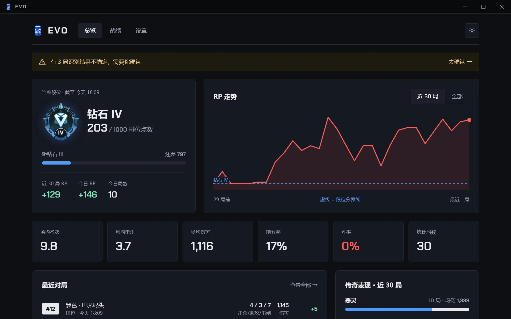
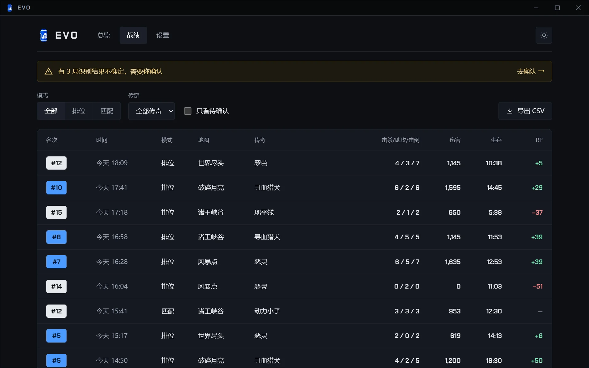
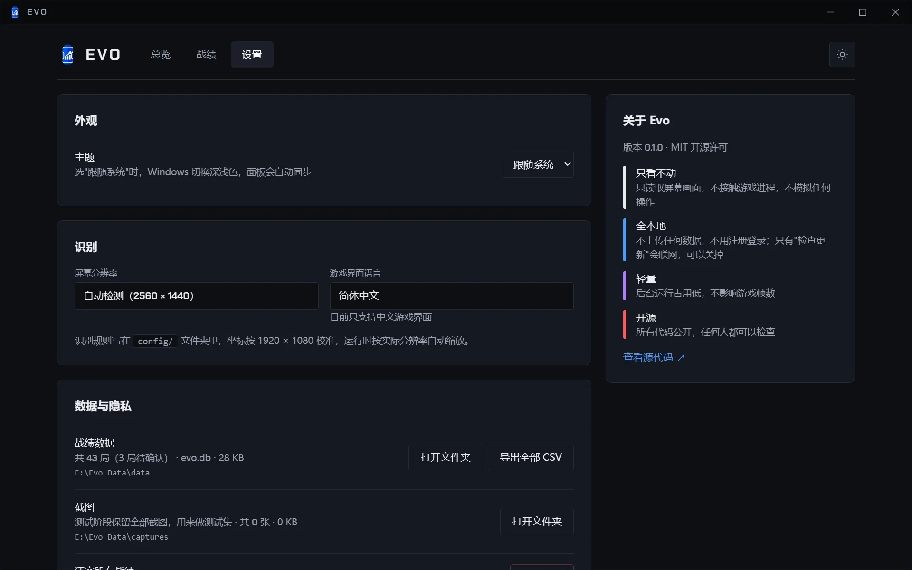

# Evo

**本地、开源、轻量的战绩记录器 · for Apex Legends**

打 Apex 时，Evo 在后台自动记下每一局的名次、击杀、伤害和排位分（RP）变化，在自己的窗口里看战绩和段位走势。所有数据只保存在你自己的电脑上。



> 现在是 **0.1.0 预览版**：只支持简体中文游戏界面，只在排位赛里测过。官网和下载：**[evotracker.cn](https://evotracker.cn)**

## 功能

- **自动记录每一局**：名次、击杀 / 助攻 / 击倒、伤害、生存时间、急救、重生，结算画面一出现就自动读取；开局时顺便记下模式和地图，对局中认出你用的传奇
- **RP 与段位走势**：从经验值页读出本局 RP 变化和段位进度，连成走势图，上分还是掉分一眼看清
- **读不准就问你**：识别把握不大的局不会悄悄写进错误数据，而是标成"待确认"，留着截图，你在战绩页对着截图改一下就行
- **全本地**：没有账号，不上传任何数据。战绩可以一键导出 CSV，用 Excel、Stata 等工具分析
- **轻量**：平时安静地待在托盘里；发现游戏在运行才开始记录，游戏一关，识别程序就退出，内存还给系统
- **多账号**（0.1.0 之后的版本）：按游戏里的名字区分账号，大小号的战绩分开统计

| 战绩：每一局的明细，可以筛选、修正、导出 | 设置：数据存在哪里、占了多少空间，一目了然 |
|---|---|
|  |  |

截图里是演示数据，界面是最新的代码，和 0.1.0 预览版略有不同。

## 只看屏幕，不碰游戏

Evo 和录屏软件一样，只截取屏幕上显示的画面，再在你自己的电脑上识别其中的文字。

| Evo 做的 | Evo 绝不做的 |
|---|---|
| 截取屏幕画面（和录屏软件相同的截屏方式） | 注入游戏，或读写游戏内存 |
| 在你的电脑上识别画面里的文字和数字 | 在游戏画面上叠加任何浮层 |
| 把结果存进本机的数据库 | 模拟键盘、鼠标操作 |
| | 查看其他玩家的段位，或提供任何竞技优势 |
| | 把你的数据上传到网络 |

作者自己开着 Evo 打过整晚的排位，没有遇到问题。但反作弊如何判定由 EA 决定，我们无法替 EA 作出保证。请了解以上做法后，自行决定是否使用。

## 下载和安装

**能不能用：**

- Windows 10 或 11（64 位）
- 游戏界面语言是**简体中文**（英文界面现在认不出）
- 游戏分辨率是 16:9，例如 1920×1080 或 2560×1440（只测过这两种）

**安装：**

1. 在 [官网](https://evotracker.cn/#download) 下载压缩包（约 103 MB，官网上有 SHA-256 可以核对）
2. 把整个压缩包**解压**到一个文件夹，比如 `D:\Evo`。不要在压缩包里直接双击运行
3. 双击 `Evo.exe`。Evo 窗口会弹出来，右下角托盘里也会出现 Evo 的蓝色图标

第一次打开时，Windows 可能提示"Windows 已保护你的电脑"：点"更多信息"→"仍要运行"。这是因为预览版还没有数字签名，不是病毒（我们正在申请 SignPath 的免费开源代码签名）。杀毒软件拦截的话，把 Evo 文件夹加入信任。

**更新**：右键托盘图标 → 退出，删掉旧的 Evo 文件夹，把新版本解压到原来的位置。数据在另一个文件夹里，不受影响。

**卸载**：右键托盘图标 → 退出，删掉 Evo 文件夹；想连数据一起删，再删掉 `%LOCALAPPDATA%\Evo`。

## 怎么用

1. 打游戏前把 Evo 打开就行。它发现 Apex 在运行，就会自动开始记录（托盘图标右下角出现小红点），不用按任何键
2. 每局结束后：
   - 在**总结**页（三张队员卡片那页）停 1–2 秒，让 Evo 读到名次、击杀、伤害
   - 点上方的**经验值**标签（手柄按 RB），等最上面的数字不再跳动再离开，Evo 才能读到这局的 RP
3. 想看战绩：双击 `Evo.exe`，或者单击托盘图标。关掉窗口，Evo 仍在托盘里继续记录
4. 彻底退出：右键托盘图标 → 退出

**已知的不足：**

- 第 2 名、冠军那种局没有总结页，伤害和生存时间会空着
- 没切到经验值页的局，RP 会空着
- 没认出传奇的局，传奇会空着，现在还不能在战绩页手动补

## 数据和隐私

- 战绩数据库、截图和运行记录都在 `%LOCALAPPDATA%\Evo` 里（在文件资源管理器的地址栏粘贴这串就能打开），也可以在 Evo 的设置页直接打开
- 预览版会保留每局的截图，用来改进识别准确率，一晚可能有几百 MB
- 唯一会联网的是"检查新版本"（0.1.0 之后的版本才有）：第一次打开时先问你，只下载官网上一个公开的版本号文件，不发送任何战绩、截图或电脑信息；有新版本只提醒，不会自动下载安装；在设置页随时可以关掉

完整说明见 [隐私政策](PRIVACY.md)。

## 反馈

- 发 [GitHub Issue](https://github.com/AugustHuangMX/Evo/issues)，或者加 [QQ 群](https://qm.qq.com/q/6L2kTbmCWc)（群号 1128519951）
- 遇到问题时，把 `%LOCALAPPDATA%\Evo\logs\evo.log` 发给我，再说一下你看到了什么；识别错的局，可以把那局的截图一起发来
- 发之前请先看一眼：截图里可能有队友和对手的游戏名，日志里可能有你的 Windows 用户名。Issue 和群聊所有人都能看到，只想给开发者看的话请在 QQ 群里私聊

## 从源码运行

需要 Windows 和 Python 3.13。

```powershell
git clone https://github.com/AugustHuangMX/Evo.git
cd Evo
py -3.13 -m venv .venv
.venv\Scripts\activate
pip install dxcam mss rapidocr onnxruntime opencv-python-headless numpy flask pywebview pystray pillow
python evo_app.py
```

- 识别模型（PP-OCRv6 small）跟着 `rapidocr` 一起装好，运行时不会联网下载
- 只装 `opencv-python-headless`，不要再装 `opencv-python`，两者会冲突
- 用源码运行时，数据（`data/`、`captures/`、`logs/`）放在项目文件夹里；设置环境变量 `EVO_DATA_DIR` 可以换到别的文件夹
- 开发时用的版本：RapidOCR 3.10、onnxruntime 1.31、dxcam 0.3、pywebview 6.2、Flask 3.1

常用命令：

| 命令 | 作用 |
|---|---|
| `python evo_app.py` | 启动 Evo（托盘 + 窗口 + 自动记录） |
| `python evo_app.py --check-image 截图.png` | 用一张截图自检识别，结果写进 `logs/evo.log` |
| `python demo_data.py` 然后 `python panel_app.py --db data/demo.db` | 用演示数据在浏览器里打开面板，不碰真实数据 |
| `python tests/run_all.py` | 跑全部测试（约 1 分钟）。测试截图不在仓库里，找不到截图的测试会显示"跳过" |
| `python build.py` | 用 PyInstaller 打包成 `dist/Evo/Evo.exe`（需要先 `pip install pyinstaller`） |

### 项目结构

| 文件 | 作用 |
|---|---|
| `evo_app.py` | 主程序：托盘图标、检测游戏、打开窗口；发现游戏时另开一个记录子进程 |
| `live_collect.py` | 记录：截屏、判断画面、识别每一局并存进数据库 |
| `screens.py` | 判断当前是哪个画面（先比外观，像了才跑文字识别） |
| `summary_page.py`、`xp_page.py`、`match_start.py`、`player_name.py`、`legends.py` | 分别识别总结页、经验值页（RP）、开局画面（模式和地图）、玩家名、传奇 |
| `post_match.py` | 一局结束后，把总结页和经验值页的数据归到同一局 |
| `ocr.py` | 文字识别（RapidOCR）：只用 CPU、单线程，用到才加载模型 |
| `storage.py` | 本地数据库（SQLite） |
| `panel_app.py`、`panel/` | 面板（Flask + HTML/CSS），只在本机 127.0.0.1 运行 |
| `app_window.py` | Evo 窗口（pywebview + Windows 自带的 WebView2） |
| `update_check.py` | 检查新版本：Evo 唯一会联网的代码 |
| `config/` | 识别规则：要看的区域、参照图、门槛。坐标按 1920×1080 写，运行时按实际分辨率缩放 |
| `tests/` | 测试：把真实截图按顺序喂给记录程序，和正确答案比对 |

识别规则都写在 `config/` 里，而不是写死在代码中。游戏更新后界面有变化时，多数情况下改配置就能修好，欢迎提交改进。

## 许可证和声明

- Evo 的代码使用 [MIT 许可证](LICENSE)
- 面板用的字体 Chakra Petch 使用 [SIL Open Font License](panel/static/fonts/OFL.txt)
- 仓库里从游戏画面截取的图片（`config/templates/` 里的画面参照图和传奇头像、`assets/ranks/` 和 `panel/static/ranks/` 里的段位徽章）版权归 Electronic Arts 所有，不适用 MIT 许可证，只用于识别画面和显示段位
- Evo 是玩家自制的非官方工具，与 Electronic Arts、Respawn Entertainment 没有任何关系，也没有得到它们的认可。Apex Legends 是 Electronic Arts Inc. 的商标
